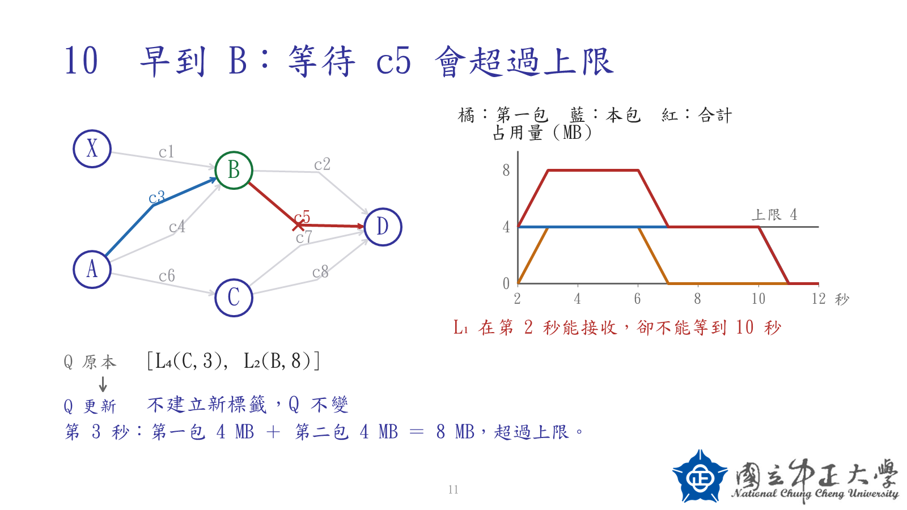

# Space DTN 碩士論文研究

以 Label Setting 處理不可分割 bundle 的最早到達路由，納入傳輸時間、contact 剩餘容量與逐 byte buffer 占用。

## 目前進度

**目前為有限時間格點與 aggregate quota 模型的演算法原型及正確性驗證階段。** 每次處理一個 bundle；接受後更新資源，再處理下一包。不主張多包聯合最佳化、連續時間最優或已支援 transmission calendar。

- [進度與下一步](PROGRESS.md)
- [更新紀錄](CHANGELOG.md)
- [現行演算法 v04](docs/sequential_label_setting_v04.md)
- [模型範圍與版本差異](docs/current_algorithm_snapshot_v01.md)
- [正確性驗證總結](docs/algorithm_validation_summary_v01.md)
- [符號與公式](docs/algorithm_symbols_and_equations_v01.md)
- [逐步搜尋說明](docs/algorithm_walkthrough_v01.md)

## 簡報與圖解

- [17 頁圖解簡報](output/presentations/整包路由_Label_Setting_圖解版_v01.pptx)
- [逐步詳解簡報](output/presentations/整包路由_Label_Setting_逐步詳解_v02.pptx)
- [17 張逐頁圖片](output/presentations/圖解版逐頁圖/)



## 執行驗證

從專案根目錄執行（已在 Python 3.12 驗證；核心搜尋與單元測試使用標準函式庫）：

```sh
python -m unittest discover -s tests -v
```

保存的驗證結果在 [output/validation](output/validation/)。繪圖程式另需 matplotlib、numpy、Pillow 與適用中文字型；它們不是執行核心測試的必要套件。

## 版本注意事項

以 `sequential_label_setting_v04.md` 與 `current_algorithm_snapshot_v01.md` 為現行定義。檔名版本號只在同一文件系列內有意義；例如 `algorithm_pseudocode_v02.md` 是舊 M0 模型，不能拿來代替現行 v04。舊文件保留研究歷程，尚待統一整理。

## 資料夾

| 路徑 | 內容 |
|---|---|
| docs/ | 研究筆記、定義、正確性論證、歷史版本 |
| src/validation/ | 搜尋原型、獨立完整搜尋、驗證工具 |
| tests/ | 單元測試 |
| output/validation/ | 已保存的測試資料、結果與反例 |
| output/presentations/ | 簡報及逐頁圖片 |
| figures/ | 研究圖解 |

原始論文 PDF、暫存檔、憑證與重複 ZIP 不納入 Git。簡報與圖片納入版本紀錄。

## 更新方式

每次完成研究或程式工作後，更新相關文件與進度、執行適用檢查，再 commit 與 push。Git 紀錄以有意義的工作單位保存；本專案未設定背景檔案監控或定時自動上傳。
