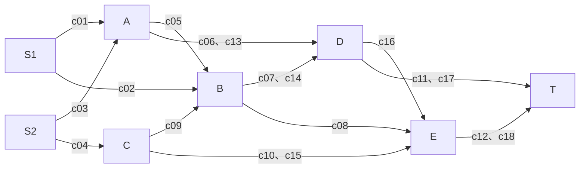

# 八節點、五個 bundles 的人工測試拓樸

這是人工構造的演算法測試資料，不是真實衛星 contact plan，也不代表統計效能結果。
不改動 PPT 演算法或現有程式。初始無既有預約，每包接受後再更新資源。

## 拓樸

同一組節點間的早、晚 contacts 是不同 ID。此圖無循環。
所有 contacts 的發送速率為 4 MB/s，每包 4 MB，整包傳輸需1秒。
Δ=1秒，觀察範圍0～24秒，contact使用半開發送時窗 [start,end)。

## 節點 Buffer

| 節點 | 上限 MB |
| --- | ---: |
| S1 | 16 |
| S2 | 16 |
| A | 8 |
| B | 4 |
| C | 8 |
| D | 4 |
| E | 8 |
| T | 16 |

B 與 D 僅能存一個完整 bundle，用來觀察等待期間的 Buffer 衝突。
S1、S2 與 T 設16MB，降低來源與目的地容量成為主要瓶頸的機率，不宣稱完全排除該限制。

## 五個 bundles

依表列順序處理。前兩包同時生成，以表列順序決定先後。

| 順序 | ID | 來源 | 目的地 | 生成時間 s | 大小 MB |
| ---: | --- | --- | --- | ---: | ---: |
| 1 | bundle1 | S1 | T | 0 | 4 |
| 2 | bundle2 | S2 | T | 0 | 4 |
| 3 | bundle3 | S1 | T | 1 | 4 |
| 4 | bundle4 | S2 | T | 2 | 4 |
| 5 | bundle5 | A | T | 3 | 4 |

## Contact plan

開始與結束指傳送端發送時窗。初始剩餘容量等於速率乘時窗長度。

| ID | 傳送端 | 接收端 | 開始 s | 結束 s | 速率 MB/s | 傳播延遲 s | 初始容量 MB |
| --- | --- | --- | ---: | ---: | ---: | ---: | ---: |
| c01 | S1 | A | 1 | 4 | 4 | 0 | 12 |
| c02 | S1 | B | 3 | 6 | 4 | 0 | 12 |
| c03 | S2 | A | 1 | 4 | 4 | 0 | 12 |
| c04 | S2 | C | 2 | 5 | 4 | 0 | 12 |
| c05 | A | B | 5 | 8 | 4 | 0 | 12 |
| c06 | A | D | 4 | 7 | 4 | 1 | 12 |
| c07 | B | D | 7 | 10 | 4 | 0 | 12 |
| c08 | B | E | 8 | 9 | 4 | 0 | 4 |
| c09 | C | B | 5 | 8 | 4 | 0 | 12 |
| c10 | C | E | 6 | 9 | 4 | 1 | 12 |
| c11 | D | T | 10 | 12 | 4 | 1 | 8 |
| c12 | E | T | 10 | 13 | 4 | 1 | 12 |
| c13 | A | D | 11 | 14 | 4 | 1 | 12 |
| c14 | B | D | 13 | 16 | 4 | 0 | 12 |
| c15 | C | E | 12 | 15 | 4 | 1 | 12 |
| c16 | D | E | 16 | 19 | 4 | 0 | 12 |
| c17 | D | T | 18 | 21 | 4 | 1 | 12 |
| c18 | E | T | 20 | 23 | 4 | 1 | 12 |

## 要觀察的五件事

1. 同一 contact 較早發送時間已預約時，是否繼續嘗試較晚時間。
2. 早到 B／D 卻不能等待時，是否保留其他晚到候選。
3. c08 只有1秒時窗與4MB容量，僅能安排一包。
4. 早班 c06／c11 不可用時，是否能改走晚班 c13／c17，或 E 支線。
5. 每包輸出 path、各跳起送／送完／完整抵達時間、失敗原因與 Q 變化。

以上是測試目標，不是已確認結果。不預設五包都應成功，也不預先指定最優路徑。

## 檔案與程式狀態

- topology.json：可替換的節點與 Buffer。
- contacts.csv：可替換的 Contact plan。
- bundles.json：可替換的五包需求與固定處理順序。
- experiment_legacy_quota.json：僅供既有 v04 載入格式，名稱明示 legacy。

**現有 v04 程式尚未加入更新 PPT 的發送時段互斥。用 legacy 設定執行所得結果，不能當作新 PPT 演算法的結果。**
本次只驗證輸入格式、節點引用、容量及格點一致性，未執行路由或大型實驗。
未生成 routes、成功率或執行時間數字。對齊新 PPT 的程式後，再使用這組資料做五包 walkthrough。

## 新版PPT驗證入口（2026-10-13）

`experiment_ppt_validation.json`由獨立的`src.ppt_validation.run`執行，加入同contact發送時段檢查、接收起送時間篩選，暫不做支配刪除。不要用legacy runner解讀此新入口。

本輪已跑完：前4包抵達12、12、13、20秒，第5包無解；7次查詢（含PPT兩包）的可行性／最早抵達皆與完整列舉一致。詳見`docs/ppt_validation_experiments_20261013.md`及`output/ppt_validation_20261013/`。
