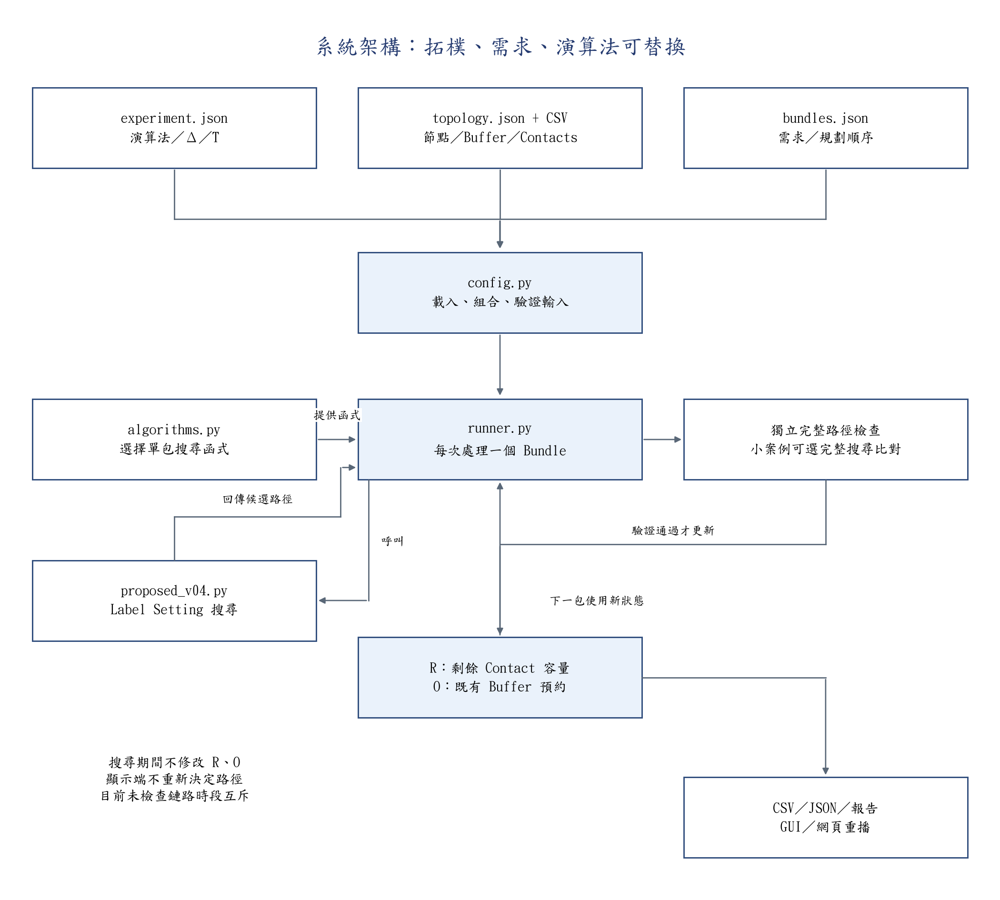
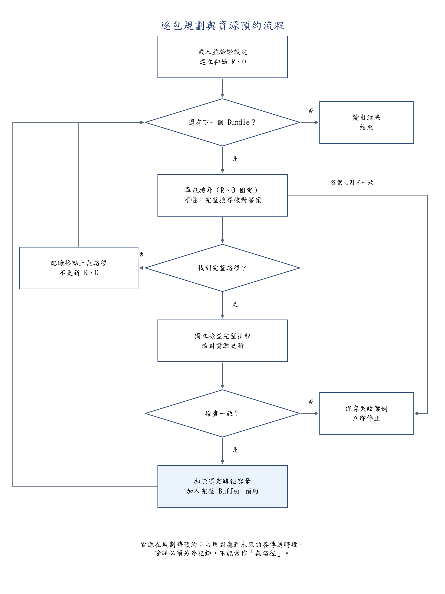
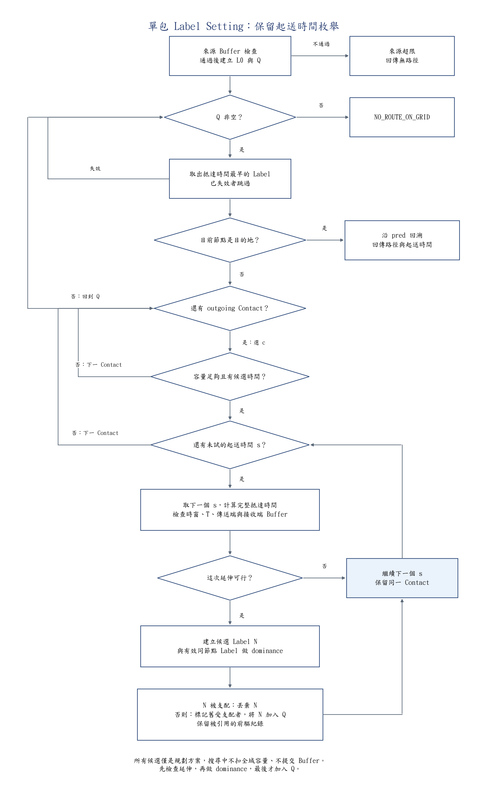

# 程式註解、架構圖與流程圖

日期：2026-10-12。本次為既有 37 個 Python 檔案及網頁重播模板補上繁體中文註解，另新增圖稿產生器。沒有更改既有路由判別式、時間枚舉、資料回傳、資源預約或測試斷言。

## 建議閱讀順序

| 順序 | 檔案 | 要看的重點 |
|---:|---|---|
| 1 | `configs/ppt_modular/experiment.json` | 拓樸、需求及演算法怎麼組合 |
| 2 | `src/experiments/config.py` | 外部輸入如何變成統一 case、格點與單位如何驗證 |
| 3 | `src/experiments/algorithms.py` | 替換搜尋函式的入口與介面 |
| 4 | `src/experiments/runner.py` | 逐包搜尋、獨立檢查、提交預約及輸出 |
| 5 | `src/validation/proposed_v04.py` | 延伸、時間枚舉、dominance、Q、pred 回溯 |
| 6 | `src/validation/model.py` | Fraction、逐 byte 曲線、峰值與預約更新 |
| 7 | `src/validation/exhaustive_oracle.py` | 小案例的獨立完整搜尋與完整排程檢查 |
| 8 | `src/experiments/report.py`、`gui.py`、`process_view.py` | 已接受排程的報告與搜尋紀錄重播 |

核心搜尋位於 validation 資料夾是既有專案位置，runner 會正式呼叫它；本次未移動檔案或重構實作。`ring_road*` 是先前實驗工具，不是閱讀 PPT 案例的必要步驟。

## 架構圖



拓樸、需求與演算法可以分別替換；驗證、預約與輸出共用。搜尋只回傳候選路徑，不直接更改全域 R、O。GUI 與網頁只顯示或呼叫執行器，不另實作一套選路方法。

## 逐包規劃流程



無路徑不提交；驗證不一致則保存並停止；接受一包後，下一包使用更新後的 R 與 O。啟用獨立完整搜尋時，連「無路徑」的答案也會核對，發現不同就停止。此流程圖的「無路徑」只適用完成搜尋的結果，TIMEOUT 必須另外記錄。

## 單包 Label Setting 流程



這裡有三層迴圈：**Q → Contact → 起送時間 s**。

- Contact 總容量不足或根本沒有可起送的時間：試下一個 Contact。
- 某一個 s 的時窗、horizon 或 Buffer 檢查失敗：試**同一個 Contact 的下一個 s**。
- 起送時間全部試完：試下一個 Contact；Contact 全部試完：回到 Q。
- 建立可行候選後才做 dominance，通過後才加入 Q。
- 被支配只標記失效；若被其他 Label 的 pred 引用，不能刪掉回溯紀錄。
- 已展開但有效的 Label 仍參與 dominance，不能把實體節點整個永久 settled。

## 註解範圍與檢查方式

既有 37 個 Python 檔案包含 src、tests 與 Windows GUI 啟動器；函式、類別及關鍵控制流程已有中文說明。歷史圖稿腳本也明列其資料來源與用途，避免把圖片重繪當成實驗。網頁模板的 JavaScript 註解說明 trace 重播、pred、顯示用插值及狀態保存。

內部 usage 仍是沿前驅鏈決定的 Contact 用量快取；本文沒有把它加回論文 Label，也沒有宣稱程式已移除快取。現行模型仍為 aggregate 容量，沒有新加鏈路時段互斥。

Python 比對採 `ast.dump(..., include_attributes=False)`，與本次修改前的 `b49e4f9` 一致；忽略註解與行號後，保留所有 docstring、常數、函式、運算及測試斷言。原始檔案位元雜湊會因加註解而改變，不等於演算法行為改變。歷史凍結文件及驗證紀錄未覆寫。網頁模板移除本次新加的註解行後，逐行等於原模板。50項既有測試通過；未啟動GUI人工操作檢查或重跑大型實驗。

## 圖檔與重建

三張圖均提供 PNG、可縮放 SVG 與 Mermaid 原始檔（`.mmd`），位於 `output/figures/code_guides_20261012/`。圖片使用標楷體。PNG 適合貼 PPT；SVG 保留文字供向量工具編輯；Mermaid 可調整節點及分支。圖是程式導讀，未產生實驗數值。

```powershell
python -m src.experiments.render_code_diagrams
python -m unittest discover -s tests -v
```

繪圖需要 matplotlib 與 Windows 標楷體，沿用專案現有的繪圖依賴位置。Mermaid 原稿不依賴 Python 繪圖環境。
