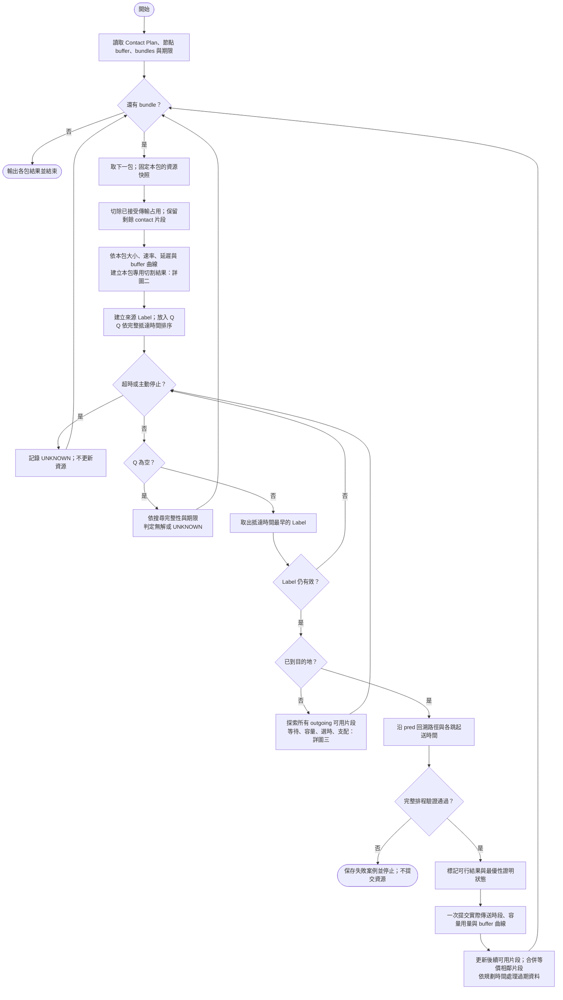
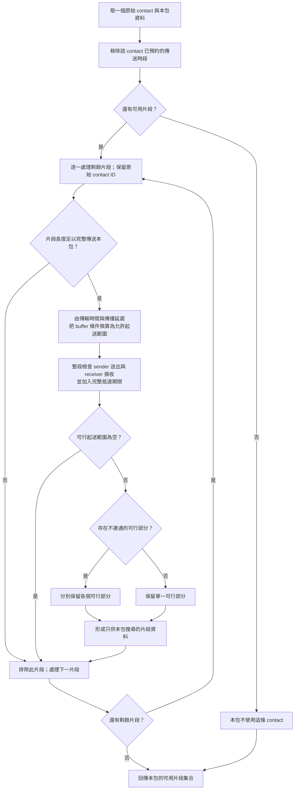
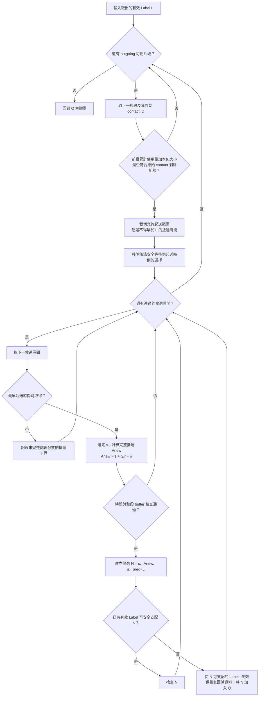

# Contact splitting 完整流程圖

日期：2026-11-02。依本次對話確認的 contact splitting 方向整理。

**後續澄清：使用者的方法是在 Label 延伸到候選 contact 時局部判定、必要時切割；不是先對本包完成整張圖的 buffer 切割。以下總流程把 F 放在 Q 初始化前，與此澄清不符，故不能當成目前方法的正確流程。保留原圖供追溯，待按最新澄清修訂；參閱 `thesis_progress_handoff_20261102.md` 第0節。**

這是候選方法的流程規格，不是已實作／證明的完整演算法。保留具體時間 Label；按需快取只是可選實作細節。未修改凍結 v04、路由程式或既有 PPT。

## 一、總流程

圖一的 F 只依本包固定資源快照計算，不依某個候選 Label 更新全域資源。下一跳等待則留在 M 處理。

## 二、什麼時候切割 contact

關鍵：物理可傳送時間與允許起送時間不同。對剩餘物理時窗 `[a,b]`，傳一包需 `d=S/r`，起送範圍先限制為 `[a,b-d]`，再與 buffer 條件求交。

buffer 進一步限制得到的可行起送集合記為 J。不能把 J 的右端直接當成新 contact 的發送結束時間，否則會重複扣除 d。片段資料必須保留原始 ID、原有物理時窗及適用的允許起送範圍；如何等價轉成單純 contact 時窗仍需驗證，不能先假定已成立。

同理，接收端在某段時間滿載，不等於把相同時間直接從傳送端 contact 刪除。切割映射必須使用完整接收占用、S/r 與傳播延遲。

這裡先處理送出與接收的局部條件；「目前 bundle 抵達後能不能等下一跳」要依前驅狀態，在圖三判斷。不能單靠圖二刪掉所有等待問題。

## 三、Label 延伸與 dominance

本圖將已確認的容量候選 A3b 保留為獨立配額。原始 contact 的各片段共用同一配額；不能每切一片就重新獲得全部容量。前綴使用次數可沿 pred 回算，不恢復已廢棄的 U 欄位。

候選支配充分條件沿用：同節點、同一可完整持有時段、抵達不晚、各原始 contact 使用次數不多。若無法證明可取代，就保留雙方；不以「早到」單獨刪除。

每個連通候選區間只取最早可取得起送時間，是仍需一般證明的候選規則；圖示不表示已證完備。搜尋產生的是計畫中的候選，並不代表實際時間已走到那一刻。

## 四、兩種切割的生命週期

| 類型 | 依據 | 影響範圍 | 更新時機 |
|---|---|---|---|
| 已預約傳送時段的切割 | 已接受路徑的實際傳送時槽 | 後續所有 bundles | 完整路徑驗證並接受後 |
| 本包 buffer 限制的切割 | 本包 S、r、δ 與固定背景曲線 | 本次 bundle 搜尋 | 本包開始時準備；結束後丟棄／失效 |

候選 Label 不新增已接受預約。多個候選是互斥方案，不能將它們的 buffer 占用相加。下一包須依新的資源快照重算本包專用條件。

合併只限原始 contact、兩端、速率、延遲與資源語意均相同的相鄰片段。刪除過期資料須依實際／滾動規劃時間，不依某個未執行 Label 的未來抵達時間，避免破壞後續較早生成 bundle 的規劃。

## 五、輸出與異常處理

- 有路徑且整段驗證通過：可提交，但最優性必須另有證據，不能因第一個目的地出 Q 就無條件標 OPTIMAL。
- 有未取得最早點的分支：沿用候選的 incompleteLB 判讀；未滿足證明前提時，只報可行／未證最優或未知。
- Q 空：只有搜尋完整且範圍／期限定義正確，才可稱該範圍內無解；否則 UNKNOWN。
- CPU 超時／停止：UNKNOWN，不當成無解。
- 完整排程驗證失敗：保存反例、停止，不照常提交或繼續做效能比較。
- 來源生成與目的地交付沿用候選 P 事件語意；圖二三的一般中繼條件不能取代其特殊端點檢查。

## 六、已完成與尚待驗證

已完成：流程整理、連續背景下的單 contact 起送區間元件與隔離測試。

尚待驗證：buffer 切割邊界與 contact 表示的等價性、前驅等待整合、最早候選與 dominance 完備性、事件跳變／開端點、完整搜尋與提交。沒有執行新版完整路由或更新 PPT。

依據：本次對話的 contact splitting 選擇，以及 `docs/1021_concrete_start_intervals_ppt_20261021.md`、`docs/demand_interval_validation_method_20261021.md`。
